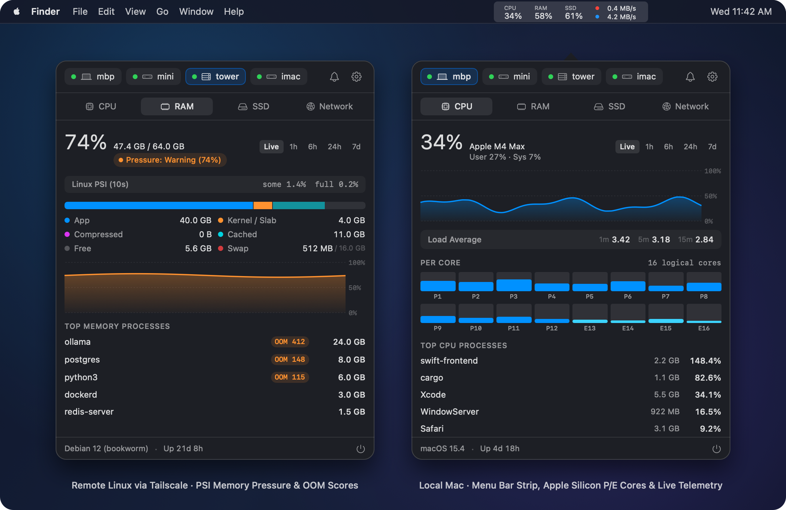
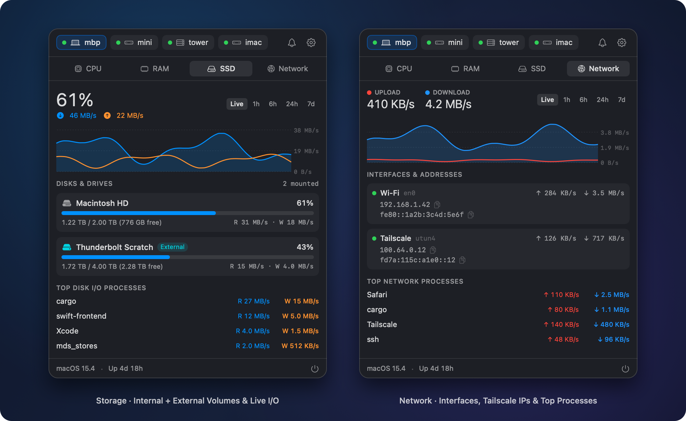
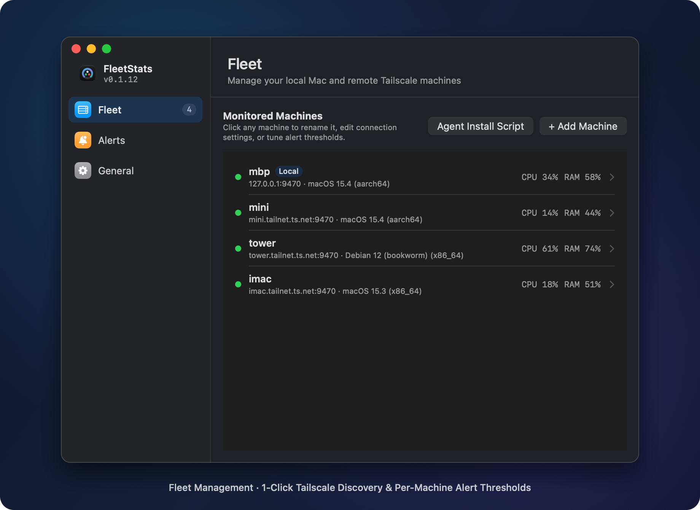

# FleetStats

A lightweight, native macOS menu bar monitor for your local Mac and your Tailscale fleet (Apple Silicon Macs, Intel Macs, and Linux).



## Features

- **Native macOS Menu Bar Strip** — Compact, zero-jitter tabular display (`CPU` · `RAM` · `SSD` · `↑↓` with synchronized network units). Click any metric to jump straight to that tab.
- **Multi-Machine Tailscale Fleet** — Monitor Apple Silicon Macs, Intel Macs, and Linux boxes (`x86_64` & `arm64`) from one popover with automatic Tailscale peer discovery and 1-click adding.
- **Deep System Telemetry**
  - **CPU**: Total %, User/Sys/IOWait, 1m/5m/15m load average, Apple Silicon P/E per-core bars, and top CPU processes.
  - **RAM**: Native macOS memory pressure & Linux PSI (`/proc/pressure/memory`), breakdown bar (App, Wired/Kernel, Compressed, Cached, Free, Swap), and Linux `oom_score` badges.
  - **Storage**: Internal & external mounted volumes, capacity bars, live Read/Write throughput, and top disk I/O processes.
  - **Network**: Live Upload/Download speeds, interfaces with copyable IPv4/IPv6 & Tailscale addresses, and top network processes.
- **Historical Charts & Forensics** — Embedded SQLite WAL ring buffer (`Live`, `1h`, `6h`, `24h`, `7d`), Linux OOM killer capture, unexpected reboot detection, sustained alert thresholds, macOS notifications, and optional agent-side webhooks (`ntfy`, `Pushover`, `Discord`, generic).
- **Private by Default** — `fleetd` binds strictly to Tailscale + loopback (`tailscale_only = true`), blocks all browser & DNS-rebinding requests (`Origin`/`Sec-Fetch-*`/`Host` + `X-FleetStats` guards), and supports zero-token Tailscale trust with optional bearer tokens for shared Tailnets.
- **Built-in Verified Auto-Updates** — Automatic and manual update checks against GitHub Releases with SHA-256 and Apple Developer ID signature verification.





## Install

### macOS App (Apple Silicon & Intel Macs)
Download the signed & notarized **`FleetStats.dmg`** from [GitHub Releases](https://github.com/erskingardner/fleet-stats/releases/latest) and drag **FleetStats.app** into `/Applications`.

### Remote Telemetry Agent (`fleetd`) — One-Line Installer

**Linux (Debian, Ubuntu, Arch, Fedora — `x86_64` & `arm64`, `systemd`):**
```bash
curl -fsSL https://raw.githubusercontent.com/erskingardner/fleet-stats/main/scripts/install.sh | sudo sh
```

**Headless Macs (Mac Mini / Intel iMac — `launchd`):**
```bash
curl -fsSL https://raw.githubusercontent.com/erskingardner/fleet-stats/main/scripts/install.sh | sh
```

*(Zero-token Tailscale-only mode is enabled by default — `fleetd` restricts peers to Tailscale/loopback IPs and blocks all browser/DNS-rebinding requests. For shared Tailnets, pass `--require-token` or `--token "fls_..."` via `sh -s -- --require-token`.)*

## Architecture

- **`agent/crates/fleetd` (Rust)**: Single native telemetry daemon (~5–10 MB RAM) with embedded SQLite ring-buffer history (2s raw for 2h + 1m rollups for 7d), sustained alert rules, Linux OOM killer & unexpected reboot forensics, optional agent-side webhooks (`ntfy`, `Pushover`, `Discord`, generic), and a Tailscale-only HTTP/SSE API (`/v1/*`) with anti-browser guards and optional bearer-token auth.
- **`apple/Packages/FleetKit` (Swift Package)**: Shared `macOS 14+` / `iOS 17+` models, SSE streaming client, Keychain token store, `@Observable` fleet state, and Swift Charts components ready for a future iOS companion app.
- **`apple/Apps/FleetStatsMac` (SwiftUI + AppKit)**: Native menu bar-only app (`LSUIElement`, bundle ID `com.paper-robin.fleetstats`) that bundles and supervises a local `fleetd` helper, renders a compact clickable strip (`CPU` · `RAM` · `SSD` · `↑↓`), and provides a multi-machine popover, macOS notifications, and in-place auto-updater.

## Building Locally & Creating a Signed DMG

```bash
# Build Universal (arm64 + x86_64) fleetd + signed FleetStats.dmg
./scripts/build-dmg.sh

# With Apple Notarization (store credentials once via xcrun notarytool store-credentials):
NOTARY_PROFILE="fleetstats-notary" ./scripts/build-dmg.sh
```

## Cutting a GitHub Release

Push a version tag to trigger `.github/workflows/release.yml`, which builds static Linux `x86_64`/`aarch64` binaries, Universal macOS `fleetd`, and a signed & notarized `FleetStats.dmg`:

```bash
git tag v0.1.0 && git push origin v0.1.0
```
